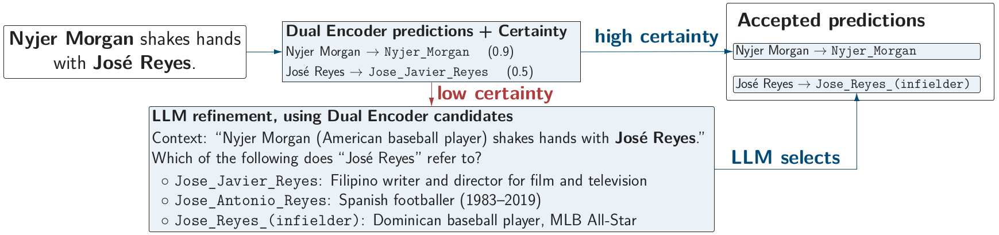

# SelectED: Selective LLM Refinement for Entity Disambiguation

**Susanna Rücker, Alexander Reinicke, Alan Akbik**

**Contact:** [Susanna Rücker](susanna.ruecker@hu-berlin.de)

3rd Workshop on Uncertainty-aware NLP (UncertaiNLP), co-located with EMNLP 2026, Budapest.

**Paper:** [Link to paper]

SelectED is a hybrid approach to entity disambiguation that combines a dual encoder with selective LLM-based refinement. Instead of invoking an LLM for every entity mention, SelectED uses certainty estimates from the dual encoder to identify uncertain predictions that may benefit from LLM refinement.

Our experiments on the ZELDA benchmark show that SelectED improves average accuracy by 4.3 percentage points, while requiring LLM inference for only approximately 20% of entity mentions.

This repository contains the evaluation code and experimental scripts used in the paper. The underlying model implementation is available in or modified Flair repository: https://github.com/flairNLP/flair/tree/SelectED



Overview of SelectED. The dual encoder handles high-certainty predictions directly, while uncertain mentions are forwarded to an LLM for refinement.

---
## Running Evaluations

This section describes how to evaluate SelectED on the datasets included in the ZELDA benchmark.

### Downloading Required Files 
  
Due to the size of some required files, not all of them are included in this repository. You will need to download two additional files found [here](https://drive.google.com/drive/folders/1uXr6OT6T1cOe9smecUQJ0zPieaOPjO0T?usp=drive_link).
These files need to be placed in the following folders:  
- ```final-model.pt``` must be placed in ```Implementation/Models/final-model/```
- ```verbalizations_structured.json``` must be placed in the root directory of this project.


### Setting up the environment

You will need to install the following libraries for Python. We have used ```Python 3.10.16``` so it is recommended that you use the same.  

- Our modified version of flair. Install using ```pip install git+https://github.com/flairNLP/flair.git@SelectED```  
- All packages listed in https://github.com/flairNLP/flair/blob/SelectED/requirements.txt
- vllm
- gradio-client
- openai
- google-genai


### Running benchmarks

The evaluate script found at ```Implementation/evaluate.py``` is the primary script used to run benchmarks on our implementation. When running the script, you can and must set a number of parameters.  

| Parameter | Required / Optional | Description |
|---|---|---|
| `--model_path <path>` | Optional | Path to the ML model (should be a .pt file. Default is `Implementation/Models/final-model/final-model.pt` |
| `--corpus <AIDA\|tweeki\|reddit-posts\|reddit-comments\|wned-wiki\|cweb\|shadowlinks-tail\|shadowlinks-shadow\|shadowlinks-top\|ace2004\|aquaint\|msnbc\|ZELDA>` | Optional | Name of the corpus. Default is `AIDA` |
| `--LLM_model_name <model name>` | REQUIRED | Name of the LLM to use. Use the exact model name from Huggingface, OpenAI or Google. If using a model from OpenAI or Google, make sure there is a .env file in the root directory containing api keys with values `GOOGLE_API_KEY` or `OPENAI_API_KEY`. |
| `--local_llm` | — | Include this parameter when running a model locally |
| `--iterations <number of iterations>` | Optional | Number of LLM iterations to perform. Default is `3` |
| `--threshold <value>` | Optional | Value for the Threshold. Default is `0.8` |
| `--LLM_selection_strategy <similarity\|similarity_abs\|difference\|difference_abs\|both>` | Optional | Strategy to use for selecting spans for prompting. Default is `similarity` |
| `--LLM_verbalization_strategy <description\|categories\|description+categories\|none>` | Optional | How to verbalize spans. Default is `description` |
| `--top_k <value>` | Optional | Number of candidates to give to the LLM. Default is `5` |
| `--spans_per_prompt <value>` | Optional | Maximum number of spans per prompt. Default is `5` |
| `--candidate_ordering <random\|sorted>` | Optional | Determines whether candidates are given sorted or in random order to the LLM. Default is `sorted` |
| `--rate_limit_timeout <value in seconds` | Optional | Number of seconds to wait between each prompting phase to avoid rate limiting. This is only relevant when using an API LLM. Default is `10` |
| `--skip_dev` | Optional | Set this parameter to skip evaluating on the development set of datasets if one is present. Recommended |
| `--max_output_tokens <value>` | Optional | Maximum number of output tokens a prompt can have. Default is `200`. When using a reasoning LLM, this must be increased. |
| `--reasoning <none\|low\|medium\|high>` | Optional | Amount of reasoning to use for reasoning LLMs. Only supported and must be set for OpenAI reasoning LLMs. Default is `none` |


(Note: This is only a selection of the parameter. To view all parameters, please take a look at ```Implementation/evaluate.py```.)  

To perform a very basic benchmark you can simply run:

```
python3 Implementation/evaluate.py \
    --LLM_model_name gemini-2.5-flash-lite \
    --corpus AIDA \
    --skip_dev
```
  
To run SelectED with the final configuration described in Table 3 of our paper, use the following command. This example evaluates the AIDA dataset.

```
python3 Implementation/evaluate.py \
    --LLM_model_name gpt-5-mini \
    --corpus AIDA \
    --skip_dev \
    --top_k 10 \
    --threshold 1 \
    --LLM_selection_strategy difference_abs \
    --LLM_verbalization_strategy categories \
    --iterations 2 \
    --spans_per_prompt 5 \
    --candidate_ordering sorted
```


### Viewing the results

The results of each evaluation run are saved in the following directory:

```Results/<dataset>/<LLM_model_type>/<LLM_model_name>/<timestamp>/```

Each directory contains the evaluation outputs, along with automatically computed statistics summarizing the results.

---

### Additional Analysis Scripts

The Python scripts (.py) and Jupyter notebooks (.ipynb) in the repository root are used for additional experiments, parameter sweeps, and analysis of benchmark results. These scripts are not required to run the main evaluations described above.
